# BunkWise: A Fuzzy-Logic (Mamdani) Attendance Decision-Support Tool

**Course:** Artificial Intelligence and Soft Computing (AISC)

**Submitted by:**

- Anvi Tiwari — Registration Number 2427030706
- Aryan Rajguru — Registration Number 2427030355

**Submitted to:** [to be added by the students]
**Department / programme / institution:** [to be added by the students]
**Date of submission:** [to be added by the students]

---

## Table of Contents

- **1. Abstract**
- **2. Introduction**
  - 2.1 Background and motivation
  - 2.2 Limits of a rigid binary decision
  - 2.3 Purpose of fuzzy logic in this project
  - 2.4 An interactive, explainable interface
  - 2.5 Scope and responsible use
- **3. Problem Statement and Objectives**
  - 3.1 Formal problem statement
  - 3.2 Input variables
  - 3.3 Output variable
  - 3.4 Objectives
  - 3.5 Intended users
- **4. Background and Theoretical Foundation**
  - 4.1 Artificial intelligence and soft computing
  - 4.2 Classical logic versus fuzzy logic
  - 4.3 Crisp values, fuzzy sets and linguistic variables
  - 4.4 Membership functions and the triangular form
  - 4.5 Fuzzification
  - 4.6 Fuzzy IF–THEN rules and fuzzy inference systems
  - 4.7 Mamdani inference
- **5. System Analysis and Design**
  - 5.1 Functional requirements
  - 5.2 Non-functional requirements
  - 5.3 Inputs, outputs and constraints
  - 5.4 Overall architecture
  - 5.5 Data flow
  - 5.6 Relationship between the fuzzy engine and the interface
  - 5.7 Explainability features
- **6. Membership Functions and Rule Base**
  - 6.1 Fuzzy sets used in the final implementation
  - 6.2 The triangular membership function and its endpoint cases
  - 6.3 The rule base
  - 6.4 Manually defined, not learned
- **7. Mamdani Inference Algorithm**
  - 7.1 Processing pipeline
  - 7.2 Input validation
  - 7.3 Fuzzification, rule evaluation and aggregation
  - 7.4 Centroid defuzzification and the zero-area fallback
  - 7.5 Raw verdict and attendance-policy override
  - 7.6 Pseudocode
- **8. Worked Numerical Example**
  - 8.1 Example 1: attendance 78%, credits 2.5, temptation 8
  - 8.2 Example 2: the attendance-policy override (attendance 72%, credits 2.5, temptation 9)
  - 8.3 What the examples demonstrate
- **9. Software Implementation**
  - 9.1 Technologies used
  - 9.2 Code organisation
  - 9.3 Application layout
  - 9.4 Visual theme
  - 9.5 Input validation and error handling
- **10. Testing and Verification**
  - 10.1 Test environment and commands
  - 10.2 Test areas and results
  - 10.3 Algorithm tests
  - 10.4 Interface tests
  - 10.5 Browser captures
- **11. Results and Discussion**
  - 11.1 Interactive behaviour
  - 11.2 Tested scenarios
  - 11.3 Sensitivity of the raw score
  - 11.4 Raw fuzzy verdict versus final recommendation
  - 11.5 Role of the 75% attendance constraint
- **12. Limitations**
- **13. Future Scope**
- **14. Conclusion**
- **References**
- **Appendix A: Complete Rule Base**
- **Appendix B: Important Parameters**
- **Appendix C: Setup, Run and Test Instructions**
- **Appendix D: Regenerating This Report**
- **Appendix E: Glossary**

## List of Figures

- Figure 5.1: Architecture of BunkWise: Streamlit presentation layer (left) and fuzzy engine (right). The dashed arrow carries the intermediate results used by the explanation tabs.
- Figure 5.2: Flowchart of the inference algorithm and the attendance-policy step, as implemented in `infer()` and `final_recommendation()`.
- Figure 6.1: Membership functions of the three inputs and of the output Bunk Score, plotted with the real `trimf()` function. Dotted vertical lines on the output panel mark the verdict thresholds 35 and 65.
- Figure 6.2: A general triangle and the two degenerate shoulder forms, evaluated with `trimf()`.
- Figure 8.1: Fuzzification of attendance 78, credits 2.5 and temptation 8. Dashed lines mark the input values; dots mark the non-zero degrees.
- Figure 8.2: Clipped “bunk” set, aggregate and centroid for Example 1. The solid line is the grid centroid computed by the implementation; the dashed line is the exact continuous value.
- Figure 8.3: Aggregate and centroid for attendance 72, credits 2.5 and temptation 9.
- Figure 9.1: BunkWise with the default inputs (78%, 2.5 credits, temptation 8). Left: input sliders and demonstration scenarios. Right: raw score gauge, final recommendation and the “Why this score?” summary. Screenshot of the running application.
- Figure 9.2: Final recommendation card for attendance 72%, credits 2.5, temptation 9: the raw score is 76.8 (“can skip”) but the mandatory attendance constraint overrides the final recommendation. Screenshot of the running application.
- Figure 9.3: “Aggregation & centroid” tab for the default inputs, showing the clip levels, the centroid computation and the aggregate. Screenshot of the running application.
- Figure 11.1: Raw Bunk Score against attendance (left, credits 2.5) and against temptation (right, attendance 78%). In the right-hand panel the curves for credits 1 and 4 coincide exactly. Dotted lines mark the thresholds 35 and 65.

## List of Tables

- Table 3.1: Input variables of BunkWise.
- Table 5.1: Functional requirements.
- Table 5.2: Non-functional requirements.
- Table 6.1: Triangular fuzzy sets (a, b, c) in the final code.
- Table 6.2: Rule base summary: consequent for low temptation / high temptation.
- Table 7.1: Processing pipeline and implementing functions.
- Table 8.1: Fuzzification of the inputs for Example 1.
- Table 8.2: Centroid of the Example 1 aggregate by different methods.
- Table 8.3: Fuzzification and rule firing for Example 2.
- Table 9.1: Technologies and their purpose in the project.
- Table 9.2: Demonstration presets and their engine outputs.
- Table 10.1: Automated tests by area, with expected behaviour and actual result.
- Table 11.1: Scenarios evaluated with the implementation.
- Table A.1: All 18 rules.
- Table B.1: Constants used by the implementation.
- Table E.1: Glossary of technical terms.

---

## 1. Abstract

Deciding whether to attend a particular class involves several considerations at once: how much attendance a student has accumulated, how much weight one class carries, and how strongly the student wants to skip. A single crisp threshold cannot express such graded judgements. This report presents **BunkWise**, an interactive decision-support tool that combines three inputs, namely attendance percentage (0–100), subject credits (1–4) and temptation to skip (0–10), into a single index called the **Bunk Score** (0–100), using a Mamdani fuzzy inference system.

The objectives were to model the decision with linguistic variables and IF–THEN rules, to implement the full Mamdani pipeline faithfully, to keep the final recommendation consistent with a mandatory 75% attendance requirement, and to make every intermediate step visible to the user. The method uses triangular membership functions (eight input sets and three output sets), an 18-rule hand-written rule base, the minimum operator for fuzzy AND, clipping implication, maximum aggregation and centroid defuzzification over a 401-point grid. The raw score is mapped to a three-way fuzzy verdict; a separate, non-fuzzy policy step then enforces that attendance below 75% always yields the recommendation to attend, without altering the raw score.

The fuzzy engine (`bunk_meter.py`, Python and NumPy) is displayed through a Streamlit application (`app.py`) that shows a score gauge, the final recommendation, the fuzzification of each input, the active rules with their firing strengths, the aggregated output with its centroid, and the membership graphs. The implementation is covered by 38 automated tests (31 algorithm tests and 7 interface tests), which all pass.

**BunkWise is a rule-based fuzzy decision-support tool. It is not a trained machine-learning predictor.** Its membership functions and rules were written by hand, nothing was learned from data, and the Bunk Score is a fuzzy index rather than a probability. The system has not been validated against real student decisions or outcomes; its limitations are discussed in Chapter 12.

**Keywords:** fuzzy logic, Mamdani inference, soft computing, centroid defuzzification, decision support, Streamlit.

## 2. Introduction

### 2.1 Background and motivation

Students regularly face a small but recurring decision: whether to attend a given class. The decision is rarely determined by one number. A student with a comfortable attendance record may still hesitate over a class that covers a great deal of syllabus, while a student close to the institutional minimum may feel more pressure over a one-credit subject in which each missed class lowers the percentage quickly. Personal inclination also plays a part. These considerations are imprecise, overlapping and expressed in words such as “comfortable”, “risky” or “heavy”, which is exactly the kind of knowledge that soft-computing techniques were designed to handle [1], [2].

### 2.2 Limits of a rigid binary decision

A conventional program would encode the decision as a chain of crisp conditions, for example “attend if attendance is below 75”. Such a rule treats 74.9% and 75.1% as categorically different and says nothing about how far from the boundary a student is. It also has no natural way to blend several factors: each extra factor multiplies the number of hard-edged cases. Fuzzy logic replaces sharp class boundaries with degrees of membership between 0 and 1 [3], so that, for instance, an attendance of 82% can be partly “ok” (0.43) and partly “safe” (0.10) at the same time, and neighbouring inputs produce neighbouring outputs.

### 2.3 Purpose of fuzzy logic in this project

The purpose of using fuzzy logic in BunkWise is to model a graded, multi-factor judgement in a transparent way. A Mamdani fuzzy inference system [4] was chosen because its rules are written in near-natural language (“IF attendance is ok AND credits are moderate AND temptation is high THEN bunk”), its inference steps can be shown one by one, and its output can be inspected as a shape rather than only as a number. The project is also a vehicle for studying the Mamdani pipeline end to end, which is the learning goal of the Artificial Intelligence and Soft Computing course.

### 2.4 An interactive, explainable interface

A bare number would offer little insight, so the system is wrapped in an interactive interface. The user moves three sliders and immediately sees the score, a recommendation and a step-by-step explanation drawn from the same inference that produced the score. Because the explanation is generated from the real intermediate results rather than written separately, the interface doubles as a teaching aid for fuzzification, rule firing, aggregation and defuzzification.

### 2.5 Scope and responsible use

BunkWise is an educational decision-support tool. It does not encourage violating attendance rules: the mandatory 75% attendance requirement is enforced as a hard constraint on the final recommendation, and the interface states that 75% is a minimum, not proof that skipping another class is safe. The scope of the work is limited to the three inputs above, a single subject at a time, and a hand-built rule base. It does not read real attendance records, does not know how many classes have been held or attended, and does not model any institutional policy other than the 75% minimum.

The rest of the report is organised as follows. Chapter 3 states the problem and objectives; Chapter 4 reviews the theory; Chapters 5 to 7 describe the design, the fuzzy sets and rules, and the inference algorithm; Chapter 8 works two examples by hand and by code; Chapters 9 and 10 cover the implementation and its testing; Chapters 11 to 14 discuss results, limitations, future scope and conclusions.

## 3. Problem Statement and Objectives

### 3.1 Formal problem statement

Let x<sub>1</sub> denote the attendance percentage, x<sub>2</sub> the subject credits and x<sub>3</sub> the temptation to skip. The problem is to construct a mapping from these three crisp inputs to a single crisp index S, the raw Bunk Score, such that a higher value indicates that skipping one class is more tolerable, and then to derive a final recommendation R that respects the mandatory attendance minimum.

$$
S=f(x_1,x_2,x_3),\qquad f:\ [0,100]\times[1,4]\times[0,10]\ \longrightarrow\ [0,100] \qquad \text{(3.1)}
$$

The function f is realised by a Mamdani fuzzy inference system. The final recommendation R is then obtained from S and x<sub>1</sub> by a crisp policy step: below 75% it is always “attend”, and otherwise it follows the three-way verdict V(S).

$$
R(S,x_1) = \begin{cases}
\mathrm{ATTEND} & x_1<75 \\
V(S) & x_1\ \geq\ 75
\end{cases} \qquad \text{(3.2)}
$$

$$
V(S) = \begin{cases}
\mathrm{CANNOT\ SKIP} & S<35 \\
\mathrm{PROCEED\ WITH\ CAUTION} & 35\leq S<65 \\
\mathrm{CAN\ SKIP} & S\geq 65
\end{cases} \qquad \text{(3.3)}
$$

### 3.2 Input variables

Table 3.1 summarises the three inputs, their ranges and their linguistic terms.

**Table 3.1: Input variables of BunkWise.**

| Variable | Range | Meaning | Linguistic terms |
| --- | --- | --- | --- |
| Attendance (x<sub>1</sub>) | 0–100 (%) | Current attendance percentage in the subject; the mandatory minimum is 75%. | danger, ok, safe |
| Subject credits (x<sub>2</sub>) | 1–4 | A rough proxy for how much one class matters: 1 is fragile (a miss lowers attendance quickly), 4 is heavy (much syllabus per class). | fragile, moderate, heavy |
| Temptation to skip (x<sub>3</sub>) | 0–10 | How strongly the user wants to skip the class: 0 not at all, 10 very strongly. Subjective, self-reported. | low, high |

### 3.3 Output variable

The raw **Bunk Score** S lies between 0 and 100 and is described by three output terms: *attend*, *maybe* and *bunk*. A higher score means that the fuzzy rules consider skipping more tolerable. The score is a fuzzy index; it is not a probability and has no frequency interpretation. Scores below 35 are read as “cannot skip the class”, scores from 35 up to but excluding 65 as “proceed with caution”, and scores of 65 or more as “can skip the class”.

### 3.4 Objectives

1. To model attendance, subject credits and temptation as linguistic variables with triangular membership functions.
2. To encode expert-style knowledge as an 18-rule IF–THEN rule base covering every combination of input terms.
3. To implement Mamdani inference (min, clipping, max, centroid) in Python so that each stage is separately testable.
4. To enforce the mandatory 75% attendance requirement as a hard, separate policy step that never alters the raw fuzzy score.
5. To build an interactive Streamlit interface that shows the score, the recommendation and every intermediate step.
6. To verify the implementation with an automated test suite and to document its limits honestly.

### 3.5 Intended users

The intended users are undergraduate students who want a structured, explainable way to think about a single attendance decision, and students and instructors of soft computing who want to see Mamdani inference working on a small, relatable problem. It is not intended as an authoritative advisory system or as a replacement for institutional attendance regulations.

## 4. Background and Theoretical Foundation

### 4.1 Artificial intelligence and soft computing

Artificial intelligence is the study of building systems that perform tasks associated with intelligent behaviour. Soft computing, a term popularised by Zadeh, is a consortium of methodologies, chiefly fuzzy logic, neural networks and probabilistic reasoning, that tolerate imprecision, uncertainty and partial truth in order to achieve tractability and robustness [1]. Fuzzy logic is the component that deals with imprecision expressed in linguistic terms, and it is the only soft-computing technique used in BunkWise.

### 4.2 Classical logic versus fuzzy logic

In classical (Boolean) logic an element either belongs to a set or does not; a statement is true or false. Fuzzy logic generalises this by allowing a degree of truth between 0 and 1 [3], [5]. The statement “attendance is safe” is then neither wholly true nor wholly false at 82%; it is true to degree 0.10. Classical logic is recovered as the special case in which all degrees are 0 or 1.

### 4.3 Crisp values, fuzzy sets and linguistic variables

A **crisp value** is an ordinary number such as an attendance of 78. A **fuzzy set** A on a universe of discourse X is characterised by a membership function μ<sub>A</sub>: X → [0, 1], which assigns to each x a degree of membership [3]:

$$
A=\{(x,\ \mu_A(x))\ \mid\ x\in X\},\qquad \mu_A:\ X\to[0,1] \qquad \text{(4.1)}
$$

A **linguistic variable** is a variable whose values are words rather than numbers, each word being a fuzzy set on an underlying numeric universe [6]. In BunkWise, “attendance” is a linguistic variable on [0, 100] with the terms danger, ok and safe; “credits” and “temptation” are defined analogously.

### 4.4 Membership functions and the triangular form

A membership function can take many shapes. The **triangular** membership function is the simplest piecewise-linear form and is defined by three parameters: the start a, the peak b and the end c, where a ≤ b ≤ c. The function rises linearly from 0 at a to 1 at b and falls linearly back to 0 at c:

$$
\mu(x;a,b,c) = \begin{cases}
0 & x<a\ \ \mathrm{or}\ \ x>c \\
1 & x=b \\
\frac{x-a}{b-a} & a\leq x<b \\
\frac{c-x}{c-b} & b<x\leq c
\end{cases} \qquad \text{(4.2)}
$$

When a = b or b = c the triangle degenerates into a right-angled “shoulder”, which is useful at the ends of a universe (for example “danger” starting at full membership at 0%). The explicit test x = b in the definition gives the value 1 at such a flat edge and prevents a division by zero; this is revisited in Chapter 6.

### 4.5 Fuzzification

**Fuzzification** converts a crisp input into the vector of membership degrees it has in each fuzzy set of its linguistic variable. For the input x<sub>1</sub> = 78, evaluating the three attendance sets gives μ<sub>danger</sub> = 0, μ<sub>ok</sub> = 1 and μ<sub>safe</sub> = 0.

### 4.6 Fuzzy IF–THEN rules and fuzzy inference systems

A fuzzy IF–THEN rule has the form “IF x<sub>1</sub> is A AND x<sub>2</sub> is C AND x<sub>3</sub> is T THEN y is O”, where A, C, T and O are fuzzy sets. The part between IF and THEN is the **antecedent**; the part after THEN is the **consequent**. A **fuzzy inference system (FIS)** is a framework that fuzzifies the inputs, evaluates a base of such rules, combines their consequents and, if a crisp answer is required, defuzzifies the result [7], [8]. The use of linguistic rules to describe complex systems goes back to Zadeh’s work on linguistic approaches to decision processes [9].

### 4.7 Mamdani inference

The Mamdani system [10], [4] represents both antecedents and consequents as fuzzy sets and produces a fuzzy output set that is then defuzzified. For rule k with antecedent sets A<sub>k</sub>, C<sub>k</sub>, T<sub>k</sub> and consequent set O<sub>k</sub>, the following operations are used.

**Fuzzy AND by the minimum t-norm.** The truth of the conjunction of two statements is the smaller of their degrees:

$$
\mu_{A\cap B}(x)=\min\left\{\mu_A(x),\ \mu_B(x)\right\} \qquad \text{(4.3)}
$$

**Rule firing strength.** The firing strength α<sub>k</sub> of rule k is the minimum of the membership degrees of the three crisp inputs x<sub>1</sub>, x<sub>2</sub>, x<sub>3</sub> in the rule’s antecedent sets:

$$
\alpha_k=\min\left\{\mu_{A_k}(x_1),\ \mu_{C_k}(x_2),\ \mu_{T_k}(x_3)\right\} \qquad \text{(4.4)}
$$

**Implication by clipping.** The consequent set is truncated at the firing strength, so a rule that is only partly true contributes only a partial shape (this is Mamdani’s min implication):

$$
\hat{\mu}_k(y)=\min\left\{\alpha_k,\ \mu_{O_k}(y)\right\} \qquad \text{(4.5)}
$$

**Aggregation by the maximum.** The clipped consequents of all rules are combined by pointwise maximum into one output fuzzy set:

$$
\mu_{\mathrm{agg}}(y)=\max_{k=1,\ldots,18}\ \hat{\mu}_k(y) \qquad \text{(4.6)}
$$

**Defuzzification by the centroid.** Defuzzification turns the aggregated fuzzy set back into a single crisp number. The **centroid** (centre of area) method [11], [12] returns the abscissa of the centre of gravity of the area under μ<sub>agg</sub>:

$$
y^{*}=\frac{\int_{0}^{100} y\,\mu_{\mathrm{agg}}(y)\,dy}{\int_{0}^{100}\mu_{\mathrm{agg}}(y)\,dy} \qquad \text{(4.7)}
$$

On a computer the integrals are approximated on a finite grid y<sub>i</sub>. BunkWise uses 401 equally spaced points y<sub>i</sub> = 0.25 i for i = 0, …, 400, so that the centroid becomes a ratio of sums:

$$
y^{*}\approx\frac{\sum_{i=0}^{400} y_i\,\mu_{\mathrm{agg}}(y_i)}{\sum_{i=0}^{400}\mu_{\mathrm{agg}}(y_i)},\qquad y_i=0.25\,i \qquad \text{(4.8)}
$$

> **Fuzzy membership is not probability.** A membership degree describes how well a value fits a vague concept; a probability describes the likelihood of an event. Attendance 82% belongs to “safe” to degree 0.10 because it only partly fits the concept, not because there is a 10% chance that it is safe. Likewise a Bunk Score of 80 is not an 80% probability that skipping is safe, and it says nothing about the chance of any outcome. It is an index on a 0–100 scale defined by the membership functions and rules. Fuzzy degrees also need not sum to one and are combined with min and max rather than with the product and sum rules of probability [3], [5].

## 5. System Analysis and Design

### 5.1 Functional requirements

Table 5.1 lists what the system must do.

**Table 5.1: Functional requirements.**

| ID | Requirement |
| --- | --- |
| FR1 | Accept attendance (0–100), subject credits (1–4) and temptation (0–10) from the user. |
| FR2 | Validate every input: present, a finite real number (not a boolean) and within its range. |
| FR3 | Fuzzify each input into degrees of membership in its fuzzy sets. |
| FR4 | Evaluate the 18-rule base with the minimum operator and report the rules whose strength is above zero. |
| FR5 | Clip, aggregate (maximum) and defuzzify (centroid) to give a raw Bunk Score from 0 to 100. |
| FR6 | Map the raw score to a raw fuzzy verdict (below 35, 35 to below 65, 65 and above). |
| FR7 | Apply the mandatory 75% attendance rule separately, giving a final recommendation without changing the raw score. |
| FR8 | Display the score, the final recommendation, an attendance warning and a plain-language explanation. |
| FR9 | Show the fuzzification, active rules, aggregation and centroid, and membership graphs. |
| FR10 | Offer demonstration presets that set the three inputs and run the same inference. |

### 5.2 Non-functional requirements

Table 5.2 lists the quality requirements that shaped the design.

**Table 5.2: Non-functional requirements.**

| Quality | Requirement |
| --- | --- |
| Transparency | All displayed numbers come from one call to `infer()`; the interface never recomputes them separately. |
| Correctness | Implementation checked by an automated test suite, including independent recomputation of key quantities. |
| Responsiveness | Inference runs on a 401-point grid and is designed for live slider use (no formal performance benchmark was made). |
| Usability | Three labelled sliders with explanatory captions, one-click presets and a readable warm light theme. |
| Maintainability | Fuzzy engine separated from the interface; fuzzy sets and rules held as plain data (`INPUTS`, `OUTPUT_SETS`, `RULES`). |
| Portability | Pure Python with NumPy, Streamlit, Plotly and pandas and no platform-specific code (developed and tested on Windows). |
| Honesty of claims | The interface and documentation state that the score is an index, not a probability, and that no learning or validation was performed. |

### 5.3 Inputs, outputs and constraints

The system takes three numeric inputs and produces four kinds of output: the raw Bunk Score, the raw fuzzy verdict, the final recommendation and the intermediate results (membership degrees, fired rules, output clip levels and the aggregated shape). The principal constraints are the fixed input ranges, the fixed rule base, the 75% attendance requirement taken from the course handout, and the fact that the system sees only the percentage, not the number of classes attended or held.

### 5.4 Overall architecture

Figure 5.1 shows the two-layer architecture. The **fuzzy engine** in `bunk_meter.py` contains all fuzzy-logic computation and has no dependency on the interface; it exposes `trimf()`, `validate_inputs()`, `infer()`, `defuzzify()`, `verdict()`, `below_attendance_minimum()` and `final_recommendation()`. The **presentation layer** in `app.py` collects the inputs, calls the engine exactly once per interaction and renders the results.

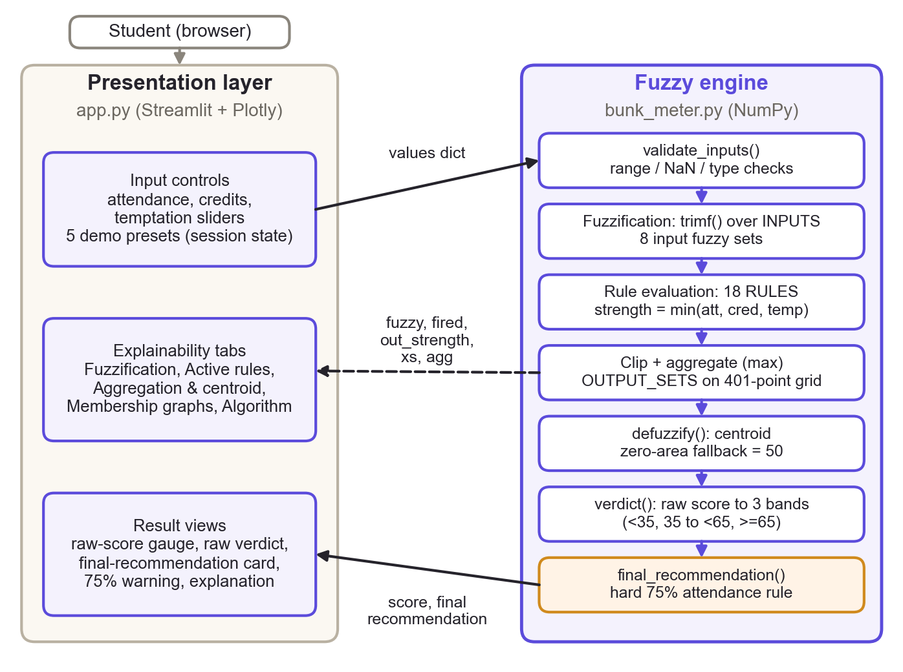

*Figure 5.1: Architecture of BunkWise: Streamlit presentation layer (left) and fuzzy engine (right). The dashed arrow carries the intermediate results used by the explanation tabs.*

### 5.5 Data flow

The data flow follows Figure 5.2. The inputs are validated; if validation fails, a `ValueError` is raised and the interface shows an error message and stops. Otherwise the inputs are fuzzified, all 18 rules are evaluated, and the strongest strength for each output set is retained. The output sets are clipped and aggregated on the 401-point grid, and the centroid is computed (with a neutral fallback of 50 if the aggregate had zero area). The raw score is then interpreted by `verdict()`, and `final_recommendation()` applies the attendance policy to give the final text shown to the user.

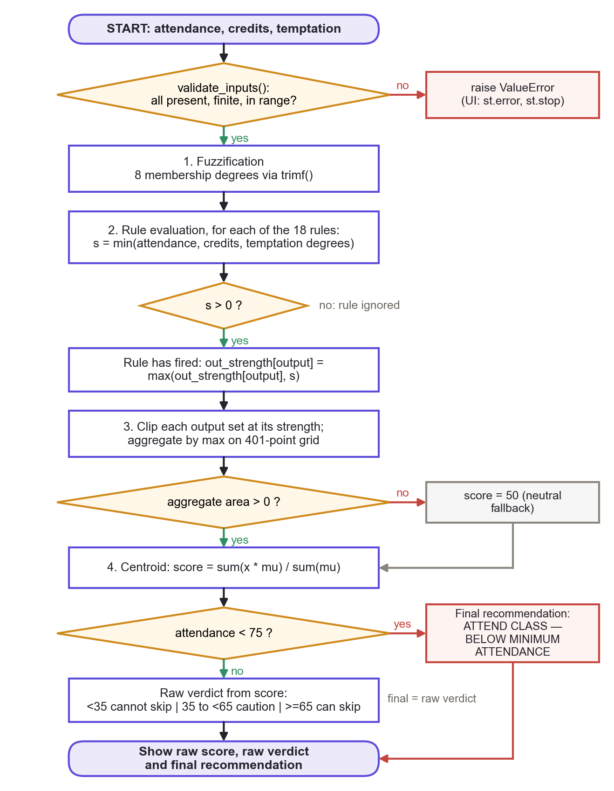

*Figure 5.2: Flowchart of the inference algorithm and the attendance-policy step, as implemented in `infer()` and `final_recommendation()`.*

### 5.6 Relationship between the fuzzy engine and the interface

The interface treats the engine as the single source of truth. `app.py` calls `bm.infer(values)` once and receives `(fuzzy, fired, out_strength, xs, agg, score)`; every figure on the screen is derived from that tuple, from `verdict()` and from `final_recommendation()`. If the engine raises a `ValueError`, the interface displays it and stops. This separation also makes the engine testable without a browser, while the interface is tested separately against the engine’s output.

### 5.7 Explainability features

Explainability is a design goal rather than an add-on. The interface shows (i) a sentence naming the strongest rule and its firing strength, (ii) a table of the degrees to which each input belongs to each fuzzy set, (iii) a table of the rules that fired, with an expander listing all 18, (iv) the clip level of each output set together with the centroid computation Σ(x·μ)/Σμ, (v) plots of the unclipped output sets, the aggregate and the centroid, (vi) membership graphs with the current input marked, and (vii) a text description of the algorithm. The raw fuzzy verdict and the final recommendation are shown separately so that the effect of the attendance policy is never hidden.

## 6. Membership Functions and Rule Base

### 6.1 Fuzzy sets used in the final implementation

Table 6.1 lists the fuzzy sets exactly as defined in `INPUTS` and `OUTPUT_SETS` in `bunk_meter.py`, and Figure 6.1 plots them. Each set is written as a triple (a, b, c) of start, peak and end.

**Table 6.1: Triangular fuzzy sets (a, b, c) in the final code.**

| Variable | Fuzzy set | (a, b, c) | Universe |
| --- | --- | --- | --- |
| Attendance | danger | (0, 0, 75) | 0–100 |
| Attendance | ok | (70, 78, 85) | 0–100 |
| Attendance | safe | (80, 100, 100) | 0–100 |
| Credits | fragile | (1, 1, 2.5) | 1–4 |
| Credits | moderate | (1.5, 2.5, 3.5) | 1–4 |
| Credits | heavy | (2.5, 4, 4) | 1–4 |
| Temptation | low | (0, 0, 6) | 0–10 |
| Temptation | high | (4, 10, 10) | 0–10 |
| Output (Bunk Score) | attend | (0, 0, 45) | 0–100 |
| Output (Bunk Score) | maybe | (30, 50, 70) | 0–100 |
| Output (Bunk Score) | bunk | (55, 100, 100) | 0–100 |

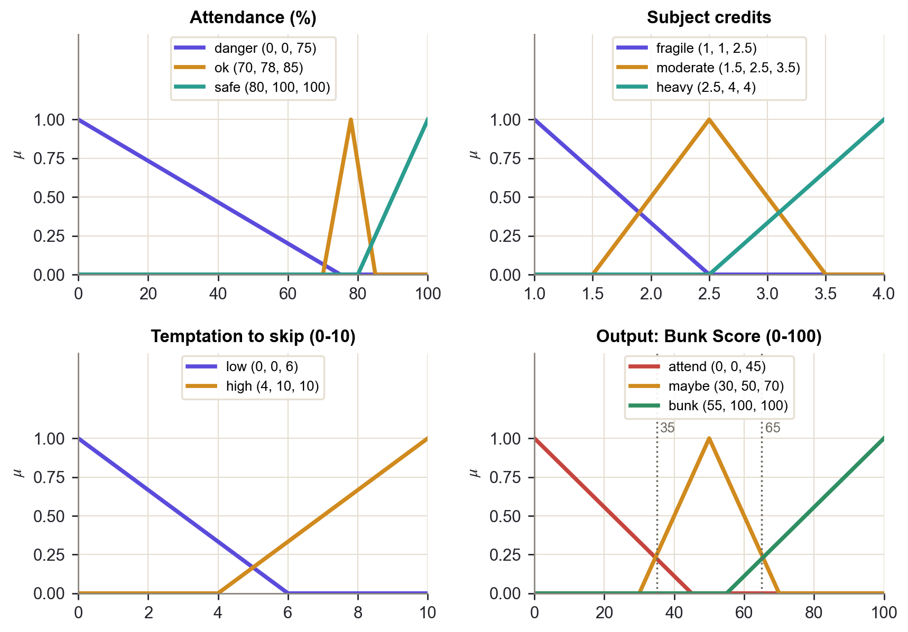

*Figure 6.1: Membership functions of the three inputs and of the output Bunk Score, plotted with the real `trimf()` function. Dotted vertical lines on the output panel mark the verdict thresholds 35 and 65.*

The design intent recorded in the source and in the presentation is as follows. The attendance sets are anchored on the 75% requirement: “danger” covers the range below 75, “ok” is a narrow peak around 78 spanning 70 to 85, and “safe” starts at 80 and reaches full membership at 100. The credit sets separate a one-credit “fragile” subject, in which a single missed class reduces attendance sharply, a “moderate” two-to-three-credit subject, and a four-credit “heavy” subject with a lot of syllabus per class. Temptation is split into “low” and “high”, which overlap between 4 and 6. The three output sets overlap so that neighbouring scores blend smoothly.

### 6.2 The triangular membership function and its endpoint cases

Eq. (4.2) is implemented by `trimf(x, a, b, c)`. Three cases deserve attention. First, outside the support (x < a or x > c) the result is 0. Second, at the peak (x = b) the result is exactly 1; this test comes before any division, so the degenerate shoulders (0, 0, 75), (1, 1, 2.5), (0, 0, 6), (0, 0, 45) and (80, 100, 100), (2.5, 4, 4), (4, 10, 10), (55, 100, 100) return 1 at their flat edge. Third, a division happens only when x lies strictly between a and b (so b − a > 0) or strictly between b and c (so c − b > 0), which means that no zero denominator can occur. At the far foot of a shoulder the formula gives 0, for example `trimf(75, 0, 0, 75) = 0`. Figure 6.2 illustrates the general triangle and both shoulder types.

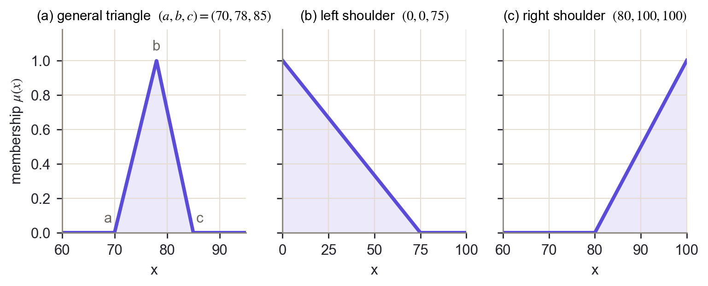

*Figure 6.2: A general triangle and the two degenerate shoulder forms, evaluated with `trimf()`.*

### 6.3 The rule base

The rule base contains 18 rules, one for each combination of 3 attendance terms, 3 credit terms and 2 temptation terms. Table 6.2 shows the consequent for low / high temptation; the complete list is given in Appendix A. The table was checked against the `RULES` list in the code when this report was generated.

**Table 6.2: Rule base summary: consequent for low temptation / high temptation.**

| Attendance | Fragile (low / high) | Moderate (low / high) | Heavy (low / high) |
| --- | --- | --- | --- |
| Danger | attend / attend | attend / maybe | attend / attend |
| Ok | attend / maybe | maybe / bunk | attend / maybe |
| Safe | maybe / maybe | maybe / bunk | maybe / bunk |

The pattern is easy to read. In the danger zone almost everything forces “attend”; the only exception is a moderate-credit subject with high temptation, which gives “maybe”. In the “ok” zone the rule base allows “bunk” only for moderate credits with high temptation, and otherwise asks for caution or attendance. In the safe zone the consequent is never “attend”, and “bunk” is returned for high temptation in moderate and heavy subjects, where the attendance buffer is large enough to absorb a missed class.

### 6.4 Manually defined, not learned

It is important to be clear about the provenance of these definitions. Every membership function and every rule was written by hand from common-sense reasoning about attendance. They were not estimated from a dataset, tuned by an optimiser or reviewed by a domain expert, and there was no training phase. The behaviour of BunkWise is therefore only as sound as these manual choices, which is discussed further in Chapter 12.

One structural property was checked by a test: over a grid of 41 × 13 × 21 valid inputs, at least one rule always fires and the aggregate always has positive area. This holds because the input sets cover their entire universes, and it is why the zero-area fallback of Chapter 7 is unreachable for validated inputs. The test supports this on the grid; it is not a formal proof for every real-valued input.

## 7. Mamdani Inference Algorithm

### 7.1 Processing pipeline

Table 7.1 summarises the ten stages of the pipeline and the functions that implement them in `bunk_meter.py`.

**Table 7.1: Processing pipeline and implementing functions.**

| # | Stage | Implementation | Result |
| --- | --- | --- | --- |
| 1 | Input validation | `validate_inputs()` | Raises ValueError or accepts |
| 2 | Fuzzification | `trimf()` over `INPUTS` | 8 membership degrees |
| 3 | Rule evaluation | loop over `RULES` in `infer()` | 18 candidate strengths |
| 4 | Firing strength = min | `min(...)` of three degrees | fired rules (s > 0) |
| 5 | Clipping | `np.minimum(s, shape)` | clipped output sets |
| 6 | Aggregation = max | `np.maximum(agg, ...)` | aggregate on 401 points |
| 7 | Centroid defuzzification | `defuzzify()` | raw Bunk Score S |
| 8 | Raw fuzzy verdict | `verdict()` | text and colour (35 / 65) |
| 9 | Attendance-policy override | `final_recommendation()` | final text and colour |
| 10 | Presentation | `app.py` | score, card, warning, explanations |

### 7.2 Input validation

`validate_inputs(values)` loops over the three input definitions. For each it raises `ValueError` if the key is missing, if the value is a boolean or not a real number (`int`, `float` or NumPy scalar), if it is not finite, or if it is outside its range. The finiteness check is essential because NaN would otherwise pass through `trimf()`: every comparison with NaN is false, so the NaN would not be caught by the range tests and would end in an invalid result (NaN or a division error). Booleans are rejected explicitly because `True` is an `int` in Python and would otherwise be accepted as 1.

### 7.3 Fuzzification, rule evaluation and aggregation

`infer(values)` first validates, then builds a dictionary `fuzzy[input][set]` of membership degrees with `trimf()`. It then iterates over `RULES`; for each rule it computes the minimum of the three antecedent degrees. Rules with strength zero are discarded, and each remaining rule is appended to the list `fired` as `(strength, attendance, credits, temptation, output)`. A dictionary `out_strength` keeps, for every output set, the largest strength among the rules that point to it.

The implementation clips and then aggregates once per output set rather than once per rule. This is equivalent to clipping every rule separately and taking the maximum of all of them, because min distributes over max:

$$
\max_{k}\ \min\left\{\alpha_k,\ \mu_{O_k}(y)\right\}=\max_{o}\ \min\left\{\beta_o,\ \mu_{o}(y)\right\},\qquad \beta_o=\max_{k:\ O_k=o}\alpha_k \qquad \text{(7.1)}
$$

Here o ranges over the three output sets. The output universe is `np.linspace(0, 100, 401)`, and the aggregate is `np.maximum(agg, np.minimum(s, shape))` accumulated over the output sets.

### 7.4 Centroid defuzzification and the zero-area fallback

`defuzzify(xs, agg)` computes `(xs * agg).sum() / agg.sum()`, which is Eq. (4.8). If the aggregate has zero area (`agg.sum() == 0`), the centroid is undefined and the function returns the neutral midpoint 50.0. This case cannot arise for validated inputs, because the input sets cover their universes and therefore at least one rule always fires; the fallback is a defensive measure that is covered by its own unit test.

### 7.5 Raw verdict and attendance-policy override

`verdict(score)` returns the raw fuzzy verdict and a colour: “CANNOT SKIP THE CLASS!!” for scores below 35, “PROCEED WITH CAUTION” from 35 up to but excluding 65, and “CAN SKIP THE CLASS” from 65. It deliberately ignores attendance. `final_recommendation(score, attendance)` then applies the policy. It first checks that the score is a finite number between 0 and 100 and that attendance is valid, then returns “ATTEND CLASS — BELOW MINIMUM ATTENDANCE” if `below_attendance_minimum(attendance)` is true (attendance < 75), and otherwise returns `verdict(score)`. The raw score is never modified.

The policy is kept outside the fuzzy system on purpose. The 75% requirement is a crisp rule, not a vague concept, so it is modelled as a hard constraint. Applying it after defuzzification leaves the membership functions and the 18 rules untouched and makes the override visible and independently testable. The final recommendation is thus a function of two quantities, the raw score and the attendance, as in the definition of R in Chapter 3.

### 7.6 Pseudocode

```text
function BUNK_SCORE(attendance, credits, temptation):
    VALIDATE all three inputs        # present, finite, in range, not boolean
    for each input variable and each of its fuzzy sets (a, b, c):
        degree[variable][set] = TRIMF(value, a, b, c)
    for each output set o: strength[o] = 0
    for each rule (A, C, T, o) in RULES:    # 18 rules
        s = MIN(degree[att][A], degree[cred][C], degree[temp][T])
        if s > 0: record rule as fired; strength[o] = MAX(strength[o], s)
    y = 401 points from 0 to 100 (step 0.25);  agg = 0 at every point
    for each output set o with parameters (a, b, c):
        agg = MAX(agg, MIN(strength[o], TRIMF(y, a, b, c)))   # clip, aggregate
    if SUM(agg) > 0: score = SUM(y * agg) / SUM(agg)      # centroid
    else:            score = 50                           # neutral fallback
    return score

function FINAL_RECOMMENDATION(score, attendance):
    CHECK score is finite and 0 <= score <= 100;  CHECK attendance is valid
    if attendance < 75: return "ATTEND CLASS - BELOW MINIMUM ATTENDANCE"
    if score < 35:      return "CANNOT SKIP THE CLASS!!"
    if score < 65:      return "PROCEED WITH CAUTION"
    return "CAN SKIP THE CLASS"
```

## 8. Worked Numerical Example

All numbers in this chapter were produced by running `infer()` and `final_recommendation()` when the report was generated. Two examples are used: the example from the presentation (attendance 78%, credits 2.5, temptation 8) and a scenario below the mandatory minimum (attendance 72%, credits 2.5, temptation 9).

### 8.1 Example 1: attendance 78%, credits 2.5, temptation 8

#### Fuzzification

**Table 8.1: Fuzzification of the inputs for Example 1.**

| Input | Value | Fuzzy set | Calculation with trimf() | Membership |
| --- | --- | --- | --- | --- |
| Attendance | 78 | danger (0, 0, 75) | 78 > c = 75, outside support | 0.000 |
|  |  | ok (70, 78, 85) | x = b = 78 | 1.000 |
|  |  | safe (80, 100, 100) | 78 < a = 80, outside support | 0.000 |
| Credits | 2.5 | fragile (1, 1, 2.5) | x = c = 2.5, (c − x)/(c − b) = 0 | 0.000 |
|  |  | moderate (1.5, 2.5, 3.5) | x = b = 2.5 | 1.000 |
|  |  | heavy (2.5, 4, 4) | x = a = 2.5, (x − a)/(b − a) = 0 | 0.000 |
| Temptation | 8 | low (0, 0, 6) | 8 > c = 6, outside support | 0.000 |
|  |  | high (4, 10, 10) | (8 − 4)/(10 − 4) = 2/3 | 0.667 |

As Table 8.1 shows, attendance belongs to “ok” with membership 1, credits belong to “moderate” with membership 1, and temptation belongs to “high” with membership (8 − 4)/(10 − 4) ≈ 0.667 (and to “low” with 0). Figure 8.1 plots these degrees.

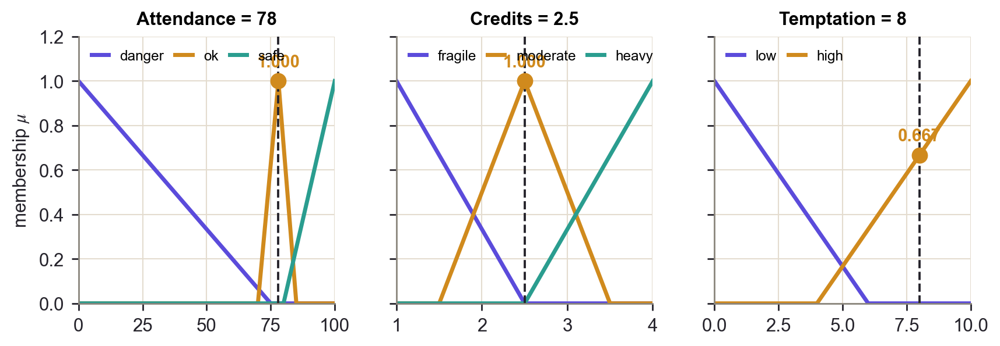

*Figure 8.1: Fuzzification of attendance 78, credits 2.5 and temptation 8. Dashed lines mark the input values; dots mark the non-zero degrees.*

#### Rule firing

Only one of the 18 rules has a non-zero strength, because for every other rule at least one antecedent degree is zero. The active rule is:

**IF** attendance is *ok* **AND** credits are *moderate* **AND** temptation is *high* **THEN** *bunk*.

$$
\alpha=\min\{\mu_{\mathrm{ok}}(78),\ \mu_{\mathrm{moderate}}(2.5),\ \mu_{\mathrm{high}}(8)\}=\min\{1,\ 1,\ 0.667\}=0.667 \qquad \text{(8.1)}
$$

The strengths of the “attend” and “maybe” sets are 0, and that of “bunk” is 0.667.

#### Clipping, aggregation and centroid

Because only “bunk” has a non-zero strength, the aggregate equals the clipped “bunk” set. The “bunk” triangle is (55, 100, 100), so it rises as (y − 55)/45. It reaches the clip level 2/3 at y = 55 + 45 × 2/3 = 85, after which the clipped set stays flat at 2/3 up to y = 100:

$$
\hat{\mu}_{\mathrm{bunk}}(y) = \begin{cases}
0 & y<55 \\
\frac{y-55}{45} & 55\leq y\leq 85 \\
\frac{2}{3} & 85<y\leq 100
\end{cases} \qquad \text{(8.2)}
$$

The aggregate is therefore a trapezoid, drawn in Figure 8.2. Its exact (continuous) centroid can be found by splitting it into a triangle (area A<sub>1</sub> = ½ × 30 × 2/3 = 10, centroid at y<sub>1</sub> = (55 + 85 + 85)/3 = 75) and a rectangle (area A<sub>2</sub> = 15 × 2/3 = 10, centroid at y<sub>2</sub> = 92.5):

$$
y^{*}=\frac{A_1\,y_1+A_2\,y_2}{A_1+A_2}=\frac{10\times 75+10\times 92.5}{10+10}=83.75 \qquad \text{(8.3)}
$$

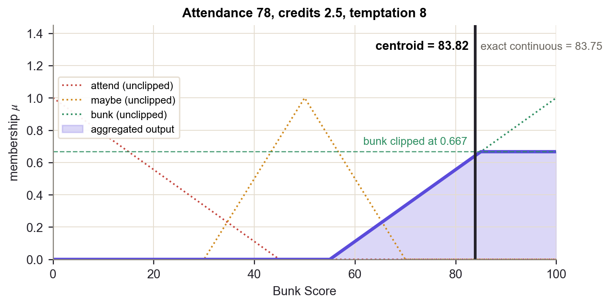

*Figure 8.2: Clipped “bunk” set, aggregate and centroid for Example 1. The solid line is the grid centroid computed by the implementation; the dashed line is the exact continuous value.*

The implementation does not integrate analytically; it applies Eq. (4.8) on the 401-point grid. Running `infer()` gives Σ(y·μ) = 6733.361 and Σμ = 80.333, hence

$$
y^{*}=\frac{6733.361}{80.333}=83.8178\approx 83.82 \qquad \text{(8.4)}
$$

**The authoritative score is the implementation’s 83.82.** The presentation gives the hand calculation as “about 83.7”; the exact value of that calculation is 83.75, and the slide figure is that value truncated. The grid result 83.82 differs from 83.75 by 0.07, so the two are not identical. The difference is a numerical discretisation effect, not an error in either calculation. Table 8.2 compares three ways of computing the centroid of the same trapezoid.

**Table 8.2: Centroid of the Example 1 aggregate by different methods.**

| Method | Σμ (or area) | Centroid |
| --- | --- | --- |
| Exact, continuous (analytic) | area = 20 (as Σμ·Δy) | 83.7500 |
| Trapezoidal rule on the same 401-point grid | 20.0000 (area) | 83.7503 |
| Sum on a 40 001-point grid (step 0.0025) | 20.0008 (as Σμ·Δy) | 83.7507 |
| Implementation: sum on 401 points (step 0.25) | 20.0833 (as Σμ·Δy) | 83.8178 |

The cause is the plain sum used on a coarse grid. On the 401-point grid the sample at y = 100 is counted with full weight, whereas the exact integral (and the trapezoidal rule) gives it half weight. This adds 0.5 × 2/3 = 1/3 to Σμ, which is why Σμ = 80.333 rather than 80 (the exact area 20 divided by the step 0.25), and it pulls the centroid slightly to the right. Refining the grid to 40 001 points, or using the trapezoidal rule, returns 83.75. The grid sum is an approximation whose error here is 0.07 of a score point, which does not affect the verdict.

#### Verdict

Since 83.82 ≥ 65, the raw fuzzy verdict is “CAN SKIP THE CLASS”. Attendance (78%) is at least 75%, so the final recommendation equals the raw verdict: “CAN SKIP THE CLASS”. This is a statement about the fuzzy index only; it does not guarantee that missing a class is safe.

### 8.2 Example 2: the attendance-policy override (attendance 72%, credits 2.5, temptation 9)

**Table 8.3: Fuzzification and rule firing for Example 2.**

| Quantity | Calculation | Value |
| --- | --- | --- |
| μ<sub>danger</sub>(72) | (75 − 72)/(75 − 0) | 0.040 |
| μ<sub>ok</sub>(72) | (72 − 70)/(78 − 70) | 0.250 |
| μ<sub>safe</sub>(72) | 72 < 80 | 0.000 |
| μ<sub>moderate</sub>(2.5) | x = b | 1.000 |
| μ<sub>high</sub>(9) | (9 − 4)/(10 − 4) | 0.833 |
| μ<sub>low</sub>(9) | 9 > 6 | 0.000 |
| Rule: danger, moderate, high → maybe | min(0.04, 1, 0.833) | 0.040 |
| Rule: ok, moderate, high → bunk | min(0.25, 1, 0.833) | 0.250 |

As Table 8.3 shows, two rules fire: “maybe” is clipped at 0.04 and “bunk” at 0.25. The aggregate (Figure 8.3) is the maximum of the two clipped shapes, and its centroid is **76.77**. This is in the “can skip” range (≥ 65), so the raw fuzzy verdict is “CAN SKIP THE CLASS”.

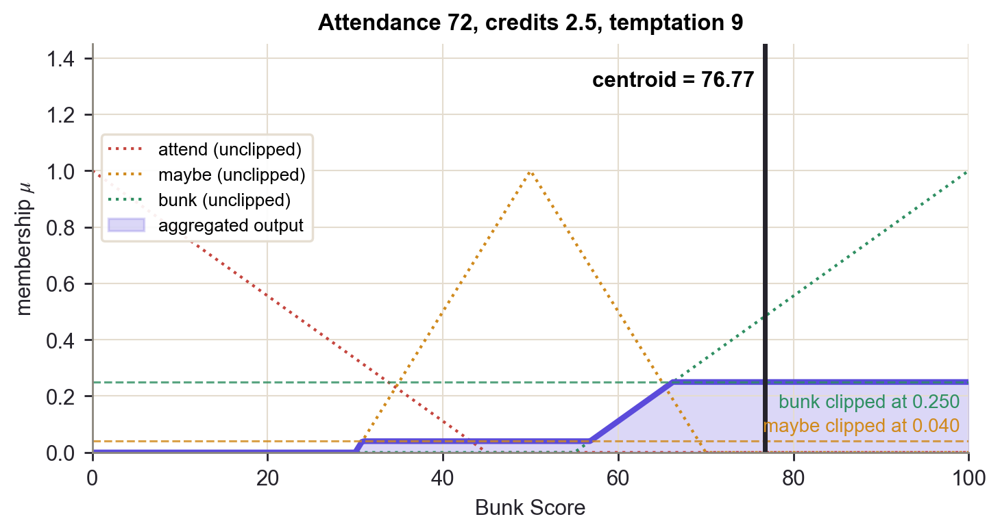

*Figure 8.3: Aggregate and centroid for attendance 72, credits 2.5 and temptation 9.*

However, attendance is 72%, which is below the mandatory 75%. `final_recommendation(76.77, 72)` therefore returns “ATTEND CLASS — BELOW MINIMUM ATTENDANCE”. The raw score 76.77 is displayed unchanged; only the final recommendation is overridden. This example shows why the policy step is needed: the “danger” set (0, 0, 75) falls away slowly, so at 72% its membership is only 0.04, while the narrow “ok” set already has membership 0.25. The fuzzy rules alone would therefore not reproduce a hard 75% rule.

### 8.3 What the examples demonstrate

Example 1 shows a single rule driving the output and the difference between an exact and a numerically approximated centroid. Example 2 shows two rules firing together, the blending of their clipped consequents, and the separation of the raw fuzzy score from the policy-aware recommendation.

## 9. Software Implementation

### 9.1 Technologies used

**Table 9.1: Technologies and their purpose in the project.**

| Technology | Version used | Purpose in BunkWise |
| --- | --- | --- |
| Python | 3.11.9 | Implementation language for the engine, interface and tests. |
| NumPy | 2.4.2 | Output universe (`np.linspace`), clipping / aggregation (`np.minimum`, `np.maximum`) and the centroid sums in `bunk_meter.py`. |
| Streamlit | 1.64.0 | Web interface: sliders, buttons, tabs, containers, metrics and tables in `app.py`; `AppTest` for headless interface tests. |
| Plotly | 7.1.0 | Interactive charts: score gauge, aggregation plot and membership graphs. |
| pandas | 3.0.5 | Data frames for the fuzzification, active-rule and full-rule tables shown by Streamlit. |
| Matplotlib | 3.10.8 | Optional legacy slider viewer in `bunk_meter.py` (imported lazily, not used by the Streamlit app); also used to draw the diagrams and plots of this report. |
| unittest | standard library | Automated test suite (algorithm and interface tests). |

The runtime requirements are `streamlit>=1.50`, `numpy>=1.26`, `plotly>=5.20` and `pandas>=2.0`; the versions in Table 9.1 are those installed on the machine used to prepare this report. [13], [14], [15], [16], [17], [18]

### 9.2 Code organisation

`bunk_meter.py` holds the fuzzy engine (about 190 lines excluding the legacy viewer): `trimf`, the `INPUTS`, `OUTPUT_SETS` and `RULES` data, `validate_inputs`, `defuzzify`, `infer`, `verdict`, `below_attendance_minimum` and `final_recommendation`. `app.py` is the Streamlit interface. `tests/` contains the unit tests and the interface tests. `.streamlit/config.toml` holds the theme. The original prototype was a Matplotlib slider program; its fuzzy sets, rules, operators and thresholds were kept, and input validation, the separate `defuzzify()`, and the policy step were added.

### 9.3 Application layout

The page uses a wide layout (maximum content width 1180 px). A header shows the BunkWise wordmark, a badge “Educational decision-support tool” and the tagline “Skip the guesswork. Know your risk.” Below it, the page is split into a left column for input and a wider right column for results, followed by a full-width explanation section. Figure 9.1 shows the default view.

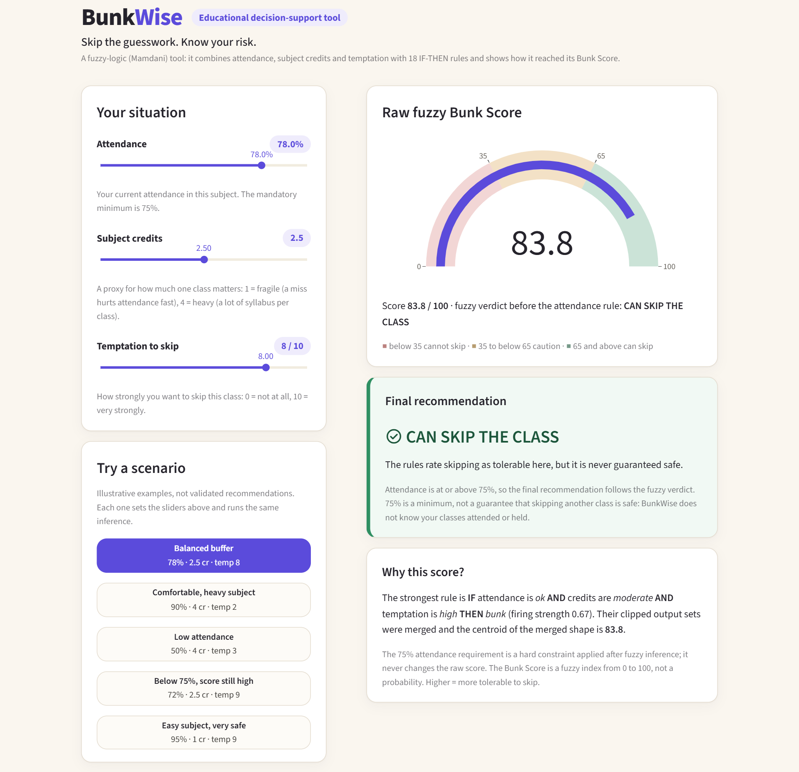

*Figure 9.1: BunkWise with the default inputs (78%, 2.5 credits, temptation 8). Left: input sliders and demonstration scenarios. Right: raw score gauge, final recommendation and the “Why this score?” summary. Screenshot of the running application.*

#### Input controls

Three sliders collect the inputs: attendance (0–100, step 0.5), subject credits (1–4, step 0.5) and temptation to skip (0–10, step 0.5). Each shows its current value in a badge and has a caption explaining it; the attendance badge turns red below 75%. Because the sliders enforce the ranges, the engine’s validation is a second line of defence rather than the first.

#### Score display, gauge and final recommendation

The “Raw fuzzy Bunk Score” card shows a Plotly gauge from 0 to 100 with three bands (red below 35, amber from 35 to below 65, green from 65), the numeric score, and the raw fuzzy verdict “before the attendance rule”. The “Final recommendation” card shows the policy-aware result with a colour-coded border and icon and a one-line supporting statement. At or above 75% a caption reminds the user that 75% is a minimum and that BunkWise does not know the classes attended or held.

#### Attendance warning

Below 75%, the final-recommendation card additionally shows a red error banner stating the attendance, the raw score and raw verdict, and that the mandatory attendance constraint overrides the final recommendation. Figure 9.2 shows the override for attendance 72%.

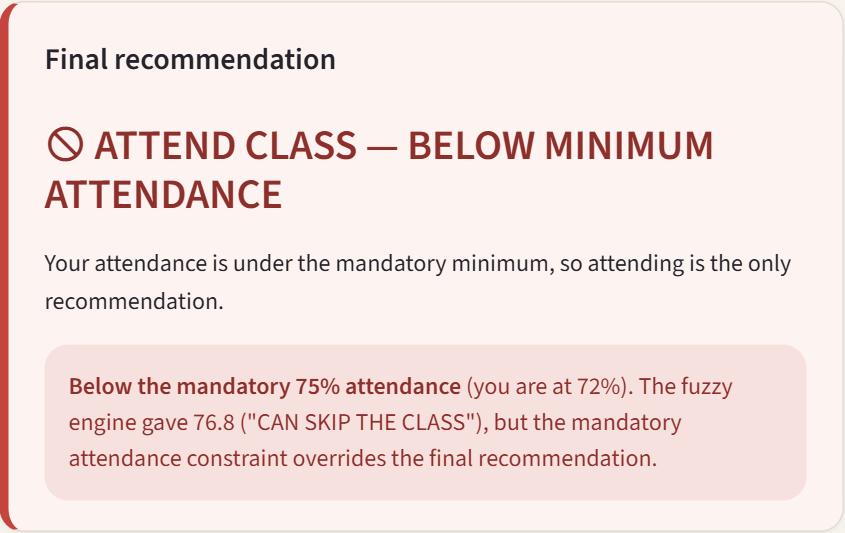

*Figure 9.2: Final recommendation card for attendance 72%, credits 2.5, temptation 9: the raw score is 76.8 (“can skip”) but the mandatory attendance constraint overrides the final recommendation. Screenshot of the running application.*

#### Demo presets

Five illustrative presets set the three sliders and re-run the same inference. They are labelled in the interface as illustrative examples, not validated recommendations. Table 9.2 lists them with the outputs of the real engine.

**Table 9.2: Demonstration presets and their engine outputs.**

| Preset | Att. | Cr. | Temp. | Raw score | Raw verdict | Final recommendation |
| --- | --- | --- | --- | --- | --- | --- |
| Balanced buffer | 78 | 2.5 | 8 | 83.82 | CAN SKIP | CAN SKIP |
| Comfortable, heavy subject | 90 | 4 | 2 | 50.00 | CAUTION | CAUTION |
| Low attendance | 50 | 4 | 3 | 18.94 | CANNOT SKIP | ATTEND (below 75%) |
| Below 75%, score still high | 72 | 2.5 | 9 | 76.77 | CAN SKIP | ATTEND (below 75%) |
| Easy subject, very safe | 95 | 1 | 9 | 50.00 | CAUTION | CAUTION |

#### Explanation tabs

The section “How the score was calculated” has five tabs. **Fuzzification** lists, for every input, a table of membership degrees with progress bars and the (a, b, c) parameters of each set. **Active rules** lists the rules with strength above zero, strongest first, and offers an expander with all 18 rules. **Aggregation & centroid** shows the clip level of each output set, the centroid computation and a plot of the unclipped sets, the aggregate and the centroid (Figure 9.3). **Membership graphs** shows one graph per input with the current value marked and the degree labelled. **Algorithm** gives a short description of the pipeline and its limits.

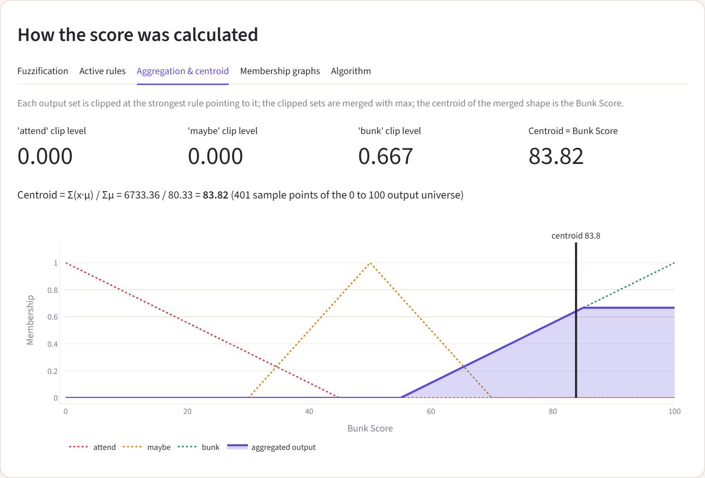

*Figure 9.3: “Aggregation & centroid” tab for the default inputs, showing the clip levels, the centroid computation and the aggregate. Screenshot of the running application.*

### 9.4 Visual theme

The interface uses a warm light theme defined in `.streamlit/config.toml`: a cream page background (#faf6ef), a slightly darker secondary background (#f1ebe0), near-black text (#25232b), an indigo primary colour (#5b4bdb), rounded white cards with a thin warm border, and red (#c5453e), amber (#c98a1b) and green (#2f8f62) as status colours. Minimal custom CSS styles the cards by their documented `key` class rather than by Streamlit’s internal class names. This report uses a more restrained shade of the same indigo as its accent colour.

### 9.5 Input validation and error handling

Invalid input is handled at two levels. The sliders constrain values to the legal ranges. If a bad value nevertheless reaches the engine through corrupted session state, `infer()` raises `ValueError`; `app.py` catches it, shows “Invalid input: …” with `st.error`, and stops the script with `st.stop()`, so no partial or misleading result is displayed. `final_recommendation()` likewise rejects a non-finite or out-of-range score and an invalid attendance.

## 10. Testing and Verification

### 10.1 Test environment and commands

The tests were run on Windows 11 (build 10.0.26300) with Python 3.11.9, NumPy 2.4.2, Streamlit 1.64.0, Plotly 7.1.0 and pandas 3.0.5. The suite uses the standard-library `unittest` framework plus Streamlit’s headless `AppTest` and is run with:

```text
python -m unittest discover -s tests -v
```

When this report was generated, the report generator ran the same test discovery programmatically. The result was: **38 tests run, 0 failures or errors, status OK**, in 9.6 s. The suite consists of 31 algorithm tests (`tests/test_bunk_meter.py`) and 7 interface tests (`tests/test_app.py`). Streamlit prints “missing ScriptRunContext” warnings during the interface tests; these are expected when a script is run in bare mode by `AppTest` and are not failures.

### 10.2 Test areas and results

Table 10.1 groups the tests by area and records the result of the run described above.

**Table 10.1: Automated tests by area, with expected behaviour and actual result.**

| Test area | Objective | Expected behaviour | Actual result |
| --- | --- | --- | --- |
| Membership functions | Check trimf() at peaks, feet, mid-slopes, outside the support and for both degenerate shoulders; check every configured set stays within [0, 1]. | Peak = 1, feet = 0, mid-slope = 0.5, outside = 0; (0, 0, 75) and (80, 100, 100) give 1 at the flat edge; no value outside [0, 1]. | 5 / 5 passed |
| Input validation | Check that infer() accepts the range limits and rejects out-of-range, NaN, infinite, non-numeric, boolean and missing inputs. | Limits accepted; every invalid case raises ValueError. | 5 / 5 passed |
| Rule base and firing strength | Check rule-base completeness, the min operator, per-rule strengths, exclusion of zero-strength rules and the max over rules that share a consequent. | 18 distinct rules; strength = min of the three degrees (2/3 for the 78 / 2.5 / 8 example); strengths > 0 only; output strength = max. | 5 / 5 passed |
| Aggregation and centroid | Check that the aggregate equals the max of the clipped sets and that the score is the centroid of that aggregate; check defuzzify() on known shapes. | Aggregate matches an independent recomputation; centroid of a symmetric block is 50, of a block on [80, 100] is 90. | 3 / 3 passed |
| Zero-area fallback and rule coverage | Check the neutral fallback and that it cannot be reached for valid inputs. | defuzzify() returns 50 for an all-zero aggregate; on a 41 x 13 x 21 grid of valid inputs at least one rule always fires. | 2 / 2 passed |
| Scores and raw verdict | Check score range, verdict thresholds, representative scenarios and the documented default score. | Finite scores in [0, 100] on a 21 x 7 x 11 grid; thresholds at 35 and 65; default score 83.82 (2 decimals). | 5 / 5 passed |
| Attendance-policy override | Check final_recommendation(): below 75 % always attend, normal thresholds at 75 % and above, raw score untouched, invalid arguments rejected. | Below 75: BELOW-MINIMUM text for every score; at 75 and above: equals verdict(); score 76.77 unchanged by the policy step. | 6 / 6 passed |
| Streamlit interface (AppTest) | Run app.py headlessly and compare what it displays with bunk_meter.infer(): default view, slider changes, all five presets, the override preset, boundary attendance values, warnings and the rule table. | Displayed score, raw verdict and final recommendation equal the engine output; error banner only below 75 %; no script exception or warning. | 7 / 7 passed |

### 10.3 Algorithm tests

The algorithm tests exercise `bunk_meter.py` directly. Several compare the engine against an independent recomputation, for example the aggregate against a freshly built maximum of clipped sets, the score against `(xs * agg).sum() / agg.sum()`, and the firing strength of the default example against `min(1, 1, 2/3)`. The boundary tests include both degenerate shoulders, and the validation tests include NaN, infinity, strings, booleans, missing keys and out-of-range values. Two grid tests sweep the valid input space to confirm that scores are finite and within 0–100 and that some rule always fires.

### 10.4 Interface tests

The interface tests load `app.py` with `AppTest`, change sliders, click every preset and compare the rendered score, raw verdict and final recommendation with `bunk_meter.infer()`, `verdict()` and `final_recommendation()`. They check that the error banner appears if and only if attendance is below 75, that the override preset still displays the unchanged raw score, that attendance of 75, 80 and 95 follow the fuzzy verdict, that no Streamlit warning appears on load, and that the active-rule table equals the rules fired by the engine.

### 10.5 Browser captures

The application screenshots in Chapter 9 were captured from a running instance of the unmodified application with an automated headless Microsoft Edge session driven by Playwright [19]; the script is `docs/capture_screenshots.py`. The captured images were inspected visually when the report was prepared. This is not a manual usability test: no formal manual test protocol, cross-browser testing or user study was carried out.

> **What the tests do and do not show.** Passing software tests show that the implementation behaves as specified and that the interface agrees with the engine. They do not show that the rule base makes academically optimal or realistic decisions. No accuracy figure, user survey or experimental validation exists for BunkWise, and none is claimed.

## 11. Results and Discussion

### 11.1 Interactive behaviour

The three sliders update every output immediately. The user can therefore explore how the raw Bunk Score changes with each input, and the explanation tabs show why: which sets are active, which rules fire, and how the clipped consequents combine. The raw fuzzy verdict and the final recommendation are shown side by side, which makes the contribution of the attendance policy explicit.

### 11.2 Tested scenarios

Table 11.1 lists scenarios evaluated by running the real code: the five presets, the two worked examples, the exact boundary at 75% and a point just below it, and a high-attendance, high-temptation case. The raw verdicts and final recommendations are abbreviated (CANNOT SKIP = “CANNOT SKIP THE CLASS!!”, CAUTION = “PROCEED WITH CAUTION”, CAN SKIP = “CAN SKIP THE CLASS”, ATTEND (below 75%) = “ATTEND CLASS — BELOW MINIMUM ATTENDANCE”).

**Table 11.1: Scenarios evaluated with the implementation.**

| Scenario | Att. | Cr. | Temp. | Rules fired | Raw score | Raw verdict | Final recommendation |
| --- | --- | --- | --- | --- | --- | --- | --- |
| Balanced buffer | 78 | 2.5 | 8 | 1 | 83.82 | CAN SKIP | CAN SKIP |
| Comfortable, heavy subject | 90 | 4 | 2 | 1 | 50.00 | CAUTION | CAUTION |
| Low attendance | 50 | 4 | 3 | 1 | 18.94 | CANNOT SKIP | ATTEND (below 75%) |
| Below 75%, score still high | 72 | 2.5 | 9 | 2 | 76.77 | CAN SKIP | ATTEND (below 75%) |
| Easy subject, very safe | 95 | 1 | 9 | 1 | 50.00 | CAUTION | CAUTION |
| Boundary: exactly 75% | 75 | 2.5 | 8 | 1 | 83.53 | CAN SKIP | CAN SKIP |
| Just below 75% | 74.9 | 2.5 | 8 | 2 | 83.37 | CAN SKIP | ATTEND (below 75%) |
| Very high attendance and temptation | 100 | 2.5 | 10 | 1 | 85.08 | CAN SKIP | CAN SKIP |

### 11.3 Sensitivity of the raw score

Figure 11.1 plots the raw score as one input varies and the others are held fixed. These curves are properties of the hand-built model, produced by the real code; they are not experimental results.

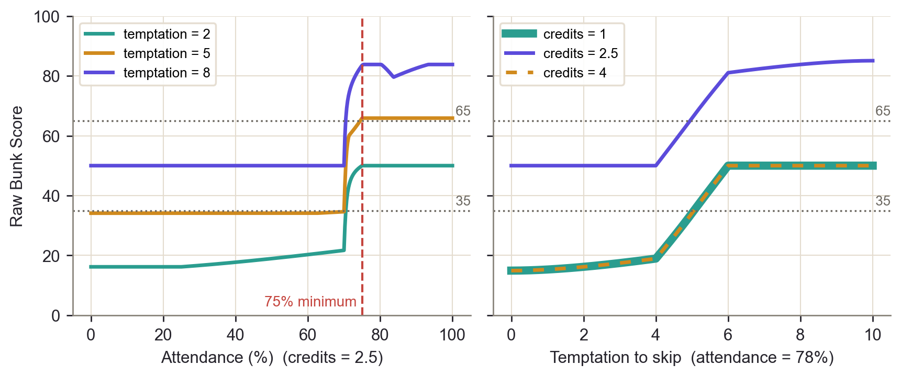

*Figure 11.1: Raw Bunk Score against attendance (left, credits 2.5) and against temptation (right, attendance 78%). In the right-hand panel the curves for credits 1 and 4 coincide exactly. Dotted lines mark the thresholds 35 and 65.*

Several observations follow. First, with credits 2.5 and temptation 8 the raw score is 50.0 at 70% attendance but 76.8 at 72% and 83.5 at 75%: the narrow “ok” set (70–85) switches on quickly while the “danger” set has a membership of at most 0.067 at 70%. Second, the raw score first reaches 65 at an attendance of 70.5% (checked in steps of 0.5 for temptations 8, 9 and 10), which is below the 75% minimum. This is the quantitative reason for the separate policy step. Third, the raw score is not monotonic in attendance in every region: for temptation 8 it is 83.8 at 80% but 80.2 at 85%, because at 85% only the “safe” set is active and with a smaller clip level the clipped “bunk” trapezoid has a lower centroid. A centroid score reflects both which output set is active and how strongly, so it should be read as an index and not as a linear measure of risk. Fourth, the temptation curves show the intended behaviour that a stronger wish to skip raises the score, but only when attendance and credits allow it: with credits 1 or 4 at 78% attendance the score never exceeds 50.

### 11.4 Raw fuzzy verdict versus final recommendation

The two outputs answer different questions. The raw verdict answers “what do the fuzzy rules say about this combination of inputs?”; the final recommendation answers “what does the mandatory attendance requirement allow?”. They agree whenever attendance is at least 75%. They can differ only below 75%, where the final recommendation is always to attend, as in the presets “Low attendance” (raw score 18.9, which already says “cannot skip”) and “Below 75%, score still high” (raw 76.8, “can skip”).

### 11.5 Role of the 75% attendance constraint

The 75% constraint is applied after defuzzification as a hard rule. At exactly 75% the normal thresholds apply; at 75% or above the interface displays a caution that 75% is a minimum and not a guarantee, since BunkWise does not know the number of classes attended or held and therefore cannot say whether missing one more class would drop the real percentage below the limit.

## 12. Limitations

**Manually chosen membership functions and rules.** Every parameter of every fuzzy set and every rule consequent was chosen by hand. Different but equally plausible choices would change the scores, and nothing in the project determines which choice is better.

**No training data and no empirical validation.** No dataset was collected, no model was trained, and BunkWise was never compared with actual student decisions or outcomes. The test suite verifies the implementation, not the realism of the rules.

**Subjective inputs.** Temptation is self-reported and has no objective scale; two users may rate the same feeling differently. Credits are chosen from a slider and are only a rough proxy for how important one class is.

**Credits as a proxy for importance.** A one-credit subject is treated as “fragile” and a four-credit subject as “heavy”, but the importance of a class also depends on its content, the instructor, assessments and the exam schedule, none of which is modelled.

**The score is not a probability.** The Bunk Score is a fuzzy index. It does not estimate the chance of any event, and a value of 80 does not mean an 80% probability that skipping is safe.

**No knowledge of classes attended or held.** The system sees only an attendance percentage. It cannot compute how many further classes may be missed before the percentage falls below the limit, because that depends on the number of classes already held and still to come.

**75% is a minimum, not a safety margin.** At 75% or more the recommendation follows the fuzzy verdict, yet an attendance just above 75% may still be one missed class away from falling below the limit. The interface says so, but the fuzzy rules do not model this distance explicitly.

**Small, fixed rule base and shape of the score.** Eighteen rules over three coarse input variables give a coarse model. Because the score is a centroid, it depends on both the active output set and its clip level, so it is not monotonic in every input (Chapter 11). The “danger” set falls slowly, which is why the policy rule had to be added separately. The 75% rule itself was taken from the course handout; no other institutional policy is modelled.

## 13. Future Scope

All items in this chapter are **proposed work**. None of them is implemented in the current version of BunkWise.

- **Expert review.** Ask faculty members or student advisers to review and adjust the membership functions and rules.
- **Survey-based tuning and evaluation.** Collect structured responses from students about how they would judge example situations, compare them with the Bunk Score, and tune the sets and rules accordingly, with appropriate consent.
- **Trapezoidal membership functions.** Replace some triangles by trapezoids to obtain plateaus of full membership, for example for a broad “safe” attendance range.
- **Additional contextual inputs.** Add variables such as proximity of examinations, importance of the particular class, or the number of classes remaining, which would need new sets and a larger rule base.
- **Real attendance records.** Integrate the number of classes attended and held, so that the tool can reason about how many further classes may be missed. This would require privacy protections for personal records.
- **ANFIS or hybrid fuzzy-neural approaches.** Once data exist, an adaptive neuro-fuzzy inference system [20] could learn membership parameters; this is a research direction, not an existing feature.
- **More systematic evaluation.** Gather user feedback and define measurable criteria for the quality of the recommendations.

## 14. Conclusion

BunkWise implements a complete Mamdani fuzzy inference system for a small, relatable decision. Three inputs are fuzzified with triangular membership functions, 18 hand-written rules are evaluated with the minimum operator, the clipped consequents are merged by maximum aggregation, and the centroid gives a raw Bunk Score between 0 and 100. A separate, crisp policy step enforces the mandatory 75% attendance requirement without altering that raw score. A Streamlit interface exposes the whole process, from membership degrees to the aggregated output, and an automated suite of 38 tests, all passing, checks that the engine behaves as specified and that the interface agrees with it.

The project demonstrates how fuzzy logic can turn linguistic knowledge into a graded, explainable computation, and how a numerical centroid (83.82) relates to its analytic value (83.75) in the worked example. What it does not demonstrate is that the rules are right: the membership functions and rules are subjective, the score has not been validated against real decisions, and the tool knows nothing about actual classes attended or held. BunkWise should therefore be regarded as an educational decision-support tool and a demonstration of soft-computing technique, not as an authority on attendance decisions.

## References

1. L. A. Zadeh, "Fuzzy logic, neural networks, and soft computing," *Communications of the ACM*, vol. 37, no. 3, pp. 77–84, Mar. 1994.
2. J.-S. R. Jang, C.-T. Sun, and E. Mizutani, *Neuro-Fuzzy and Soft Computing: A Computational Approach to Learning and Machine Intelligence*. Upper Saddle River, NJ, USA: Prentice Hall, 1997.
3. L. A. Zadeh, "Fuzzy sets," *Information and Control*, vol. 8, no. 3, pp. 338–353, 1965. doi:10.1016/S0019-9958(65)90241-X.
4. E. H. Mamdani and S. Assilian, "An experiment in linguistic synthesis with a fuzzy logic controller," *International Journal of Man-Machine Studies*, vol. 7, no. 1, pp. 1–13, 1975.
5. G. J. Klir and B. Yuan, *Fuzzy Sets and Fuzzy Logic: Theory and Applications*. Upper Saddle River, NJ, USA: Prentice Hall, 1995.
6. L. A. Zadeh, "The concept of a linguistic variable and its application to approximate reasoning—I," *Information Sciences*, vol. 8, no. 3, pp. 199–249, 1975.
7. C. C. Lee, "Fuzzy logic in control systems: fuzzy logic controller—Part I," *IEEE Transactions on Systems, Man, and Cybernetics*, vol. 20, no. 2, pp. 404–418, Mar./Apr. 1990.
8. T. J. Ross, *Fuzzy Logic with Engineering Applications*, 3rd ed. Chichester, U.K.: Wiley, 2010.
9. L. A. Zadeh, "Outline of a new approach to the analysis of complex systems and decision processes," *IEEE Transactions on Systems, Man, and Cybernetics*, vol. SMC-3, no. 1, pp. 28–44, Jan. 1973.
10. E. H. Mamdani, "Application of fuzzy algorithms for control of simple dynamic plant," *Proceedings of the IEE*, vol. 121, no. 12, pp. 1585–1588, Dec. 1974.
11. C. C. Lee, "Fuzzy logic in control systems: fuzzy logic controller—Part II," *IEEE Transactions on Systems, Man, and Cybernetics*, vol. 20, no. 2, pp. 419–435, Mar./Apr. 1990.
12. W. Van Leekwijck and E. E. Kerre, "Defuzzification: criteria and classification," *Fuzzy Sets and Systems*, vol. 108, no. 2, pp. 159–178, 1999.
13. Python Software Foundation, *The Python Language Reference* and *unittest — Unit testing framework*, Python 3 documentation. [Online]. Available: https://docs.python.org/3/
14. C. R. Harris et al., "Array programming with NumPy," *Nature*, vol. 585, pp. 357–362, 2020. doi:10.1038/s41586-020-2649-2.
15. Streamlit Inc., *Streamlit documentation* (including the App testing API). [Online]. Available: https://docs.streamlit.io/
16. Plotly Technologies Inc., *Plotly Python Graphing Library documentation*. [Online]. Available: https://plotly.com/python/
17. W. McKinney, "Data structures for statistical computing in Python," in *Proc. 9th Python in Science Conference (SciPy 2010)*, 2010, pp. 56–61.
18. J. D. Hunter, "Matplotlib: a 2D graphics environment," *Computing in Science & Engineering*, vol. 9, no. 3, pp. 90–95, 2007.
19. Microsoft, *Playwright for Python documentation*. [Online]. Available: https://playwright.dev/python/
20. J.-S. R. Jang, "ANFIS: adaptive-network-based fuzzy inference system," *IEEE Transactions on Systems, Man, and Cybernetics*, vol. 23, no. 3, pp. 665–685, May/Jun. 1993.
21. S. Canny et al., *python-docx documentation*. [Online]. Available: https://python-docx.readthedocs.io/

## Appendix A: Complete Rule Base

Table A.1 lists the 18 rules in the order in which they appear in `RULES` in `bunk_meter.py`. The weakest consequent is “attend” and the strongest is “bunk”.

**Table A.1: All 18 rules.**

| # | Attendance | Credits | Temptation | THEN (Bunk Score is) |
| --- | --- | --- | --- | --- |
| R1 | danger | fragile | low | attend |
| R2 | danger | fragile | high | attend |
| R3 | danger | moderate | low | attend |
| R4 | danger | moderate | high | maybe |
| R5 | danger | heavy | low | attend |
| R6 | danger | heavy | high | attend |
| R7 | ok | fragile | low | attend |
| R8 | ok | fragile | high | maybe |
| R9 | ok | moderate | low | maybe |
| R10 | ok | moderate | high | bunk |
| R11 | ok | heavy | low | attend |
| R12 | ok | heavy | high | maybe |
| R13 | safe | fragile | low | maybe |
| R14 | safe | fragile | high | maybe |
| R15 | safe | moderate | low | maybe |
| R16 | safe | moderate | high | bunk |
| R17 | safe | heavy | low | maybe |
| R18 | safe | heavy | high | bunk |

## Appendix B: Important Parameters

Table B.1 collects the constants that control the behaviour of the implementation.

**Table B.1: Constants used by the implementation.**

| Parameter | Value | Where |
| --- | --- | --- |
| Mandatory attendance minimum | 75% | `ATTENDANCE_MIN`, `below_attendance_minimum()` |
| Output universe | 0–100, 401 points (step 0.25) | `np.linspace(0, 100, 401)` in `infer()` |
| Verdict thresholds | below 35; 35 to below 65; 65 and above | `verdict()` |
| Zero-area fallback score | 50.0 | `defuzzify()` |
| Input ranges | attendance 0–100; credits 1–4; temptation 0–10 | `INPUTS`, `validate_inputs()` |
| Default inputs (interface) | attendance 78, credits 2.5, temptation 8 | `DEFAULTS` in `app.py` |
| Slider steps | 0.5 for all three inputs | `st.slider` in `app.py` |
| Number of rules | 18 = 3 × 3 × 2 | `RULES` |
| Fuzzy operators | AND = min; rules sharing a consequent = max; implication = clip; aggregation = max | `infer()` |
| Defuzzification | centroid, Σ(y·μ)/Σμ | `defuzzify()` |

## Appendix C: Setup, Run and Test Instructions

On Windows with PowerShell (from the project README):

```text
git clone https://github.com/AryanRajguru22/Bunkwise.git
cd Bunkwise
python -m venv .venv
.venv\Scripts\Activate.ps1
pip install -r requirements.txt
streamlit run app.py
```

The application opens in the browser, by default at http://localhost:8501. The optional legacy Matplotlib viewer can be started with `python bunk_meter.py` (requires Matplotlib). The tests are run with:

```text
python -m unittest discover -s tests -v        # all 38 tests
python -m unittest tests.test_bunk_meter -v     # 31 algorithm tests
python -m unittest tests.test_app -v            # 7 interface tests
```

## Appendix D: Regenerating This Report

The report is produced by `docs/generate_final_report.py`, which runs the real `infer()` code and the real test suite, draws the figures with Matplotlib, writes the Markdown and Word versions from a single content definition (`docs/final_report_content.py`), and then asks Microsoft Word to update the table of contents and list fields and to export the PDF. Additional dependencies beyond `requirements.txt` are listed in `requirements-docs.txt` (python-docx, Matplotlib; Playwright only for the screenshots). Word is needed on the machine for the PDF export. The cover-page placeholders are set in the `COVER` dictionary at the top of that script. [21]

## Appendix E: Glossary

Table E.1 defines the technical terms used in this report.

**Table E.1: Glossary of technical terms.**

| Term | Meaning |
| --- | --- |
| Aggregation | Combining the clipped consequents of all rules into one fuzzy set (here by pointwise maximum). |
| Antecedent / consequent | The IF part and the THEN part of a rule. |
| Bunk Score | BunkWise’s raw output index, 0–100; higher means skipping is more tolerable under the rules. Not a probability. |
| Centroid | Centre of area of a fuzzy set; used here to defuzzify the aggregate. |
| Clipping | Truncating a consequent fuzzy set at the firing strength of its rule (Mamdani min implication). |
| Crisp value | An ordinary number or a Boolean, as opposed to a degree of membership. |
| Defuzzification | Converting a fuzzy set into a single crisp number. |
| Firing strength | The degree to which a rule’s antecedent is satisfied; here the minimum of three membership degrees. |
| Fuzzification | Converting a crisp input into membership degrees in fuzzy sets. |
| Fuzzy inference system | A system that maps crisp inputs to outputs through fuzzification, rules, aggregation and defuzzification. |
| Fuzzy set | A set in which each element has a degree of membership between 0 and 1. |
| Linguistic variable | A variable whose values are words, each defined by a fuzzy set. |
| Mamdani inference | A fuzzy inference style in which rule consequents are fuzzy sets, combined and then defuzzified. |
| Membership function | A function giving the degree of membership of a value in a fuzzy set. |
| Soft computing | A family of methods (fuzzy logic, neural networks, probabilistic reasoning) tolerant of imprecision and uncertainty. |
| t-norm | A fuzzy AND operator; the minimum is the one used here. |
| Triangular membership function | A membership function defined by start a, peak b and end c. |
